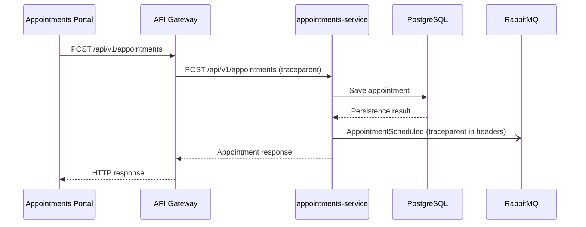

# CP1 - Critical Journey and Trace Map

## 1. Critical User Journey

**Project:** DILUCCA

**Module:** Appointments

**Journey:** Dental Appointment Scheduling

**Main endpoint:** POST /api/v1/appointments

### Description

The journey begins when an authorized staff member schedules
a dental appointment using the Appointments Portal.

The request passes through the API Gateway to the
appointments-service, where business rules and appointment
availability are validated.

The appointment is persisted in PostgreSQL. The system
also defines the AppointmentScheduled event for
asynchronous integration.

This journey is selected because failures during scheduling
can affect appointment availability and user experience.

## 2. Hop Table

| Step | Caller | Callee | Protocol | Operation | Sync/Async | Data |
|---|---|---|---|---|---|---|
| 1 | Appointments Portal | API Gateway | HTTP/REST | POST /api/v1/appointments | Sync | Appointment request |
| 2 | API Gateway | appointments-service | HTTP/REST | POST /api/v1/appointments | Sync | Appointment data |
| 3 | appointments-service | PostgreSQL | SQL | Save appointment | Sync | Appointment record |
| 4 | appointments-service | RabbitMQ | AMQP | AppointmentScheduled | Async | Appointment event |

**Design note:** The asynchronous event publication is
described as part of the documented architecture.
Its runtime implementation must be verified separately.

## 3. Mermaid Sequence Diagram

**Trace propagation:** The trace context must be propagated
through HTTP using the W3C traceparent header. For
asynchronous messaging, the trace context must be included
in the message headers.

**Implementation status:** This diagram represents the
intended observable journey, not verified runtime tracing.

## 4. Span Tree

All spans in the journey share the same trace_id.
Each operation has its own span_id.

- Root span: Appointment scheduling request
  - Child span: API Gateway request processing
    - Child span: appointments-service scheduling
      - Child span: PostgreSQL appointment persistence
      - Child span: AppointmentScheduled event producer
        - Async boundary: RabbitMQ message headers

### Trace Context

- trace_id: Identifies the complete distributed request.
- span_id: Identifies an individual operation.
- traceparent: Carries the W3C trace context through HTTP.
- Message headers: Carry the trace context across RabbitMQ.

The spans above define the proposed instrumentation.
